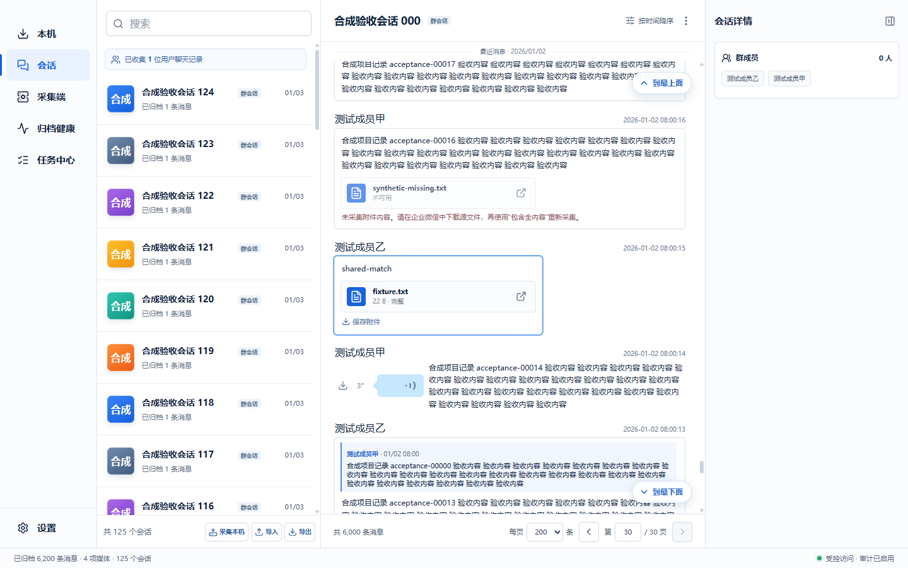
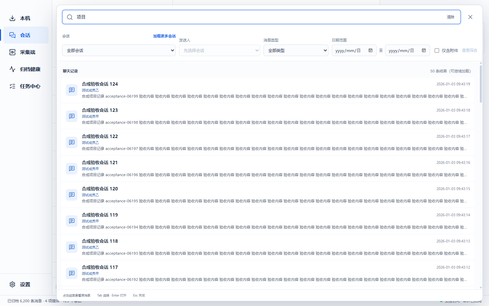
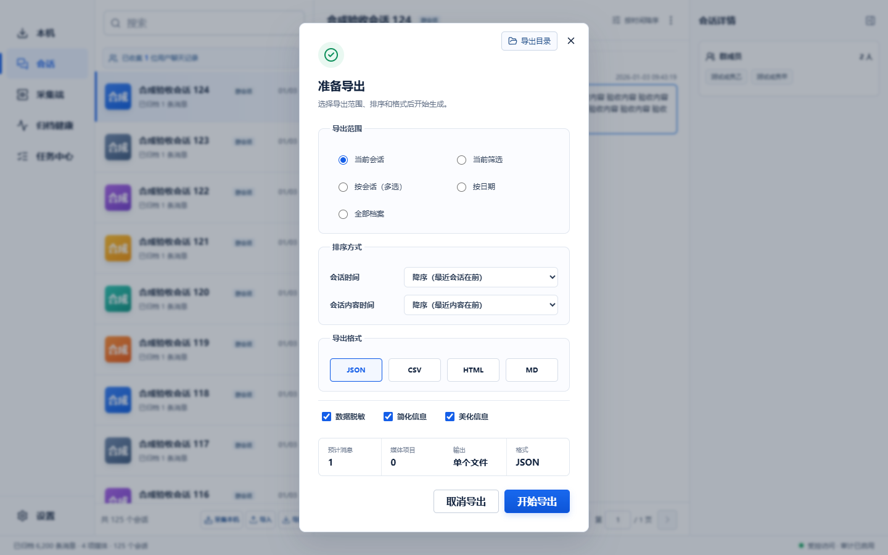
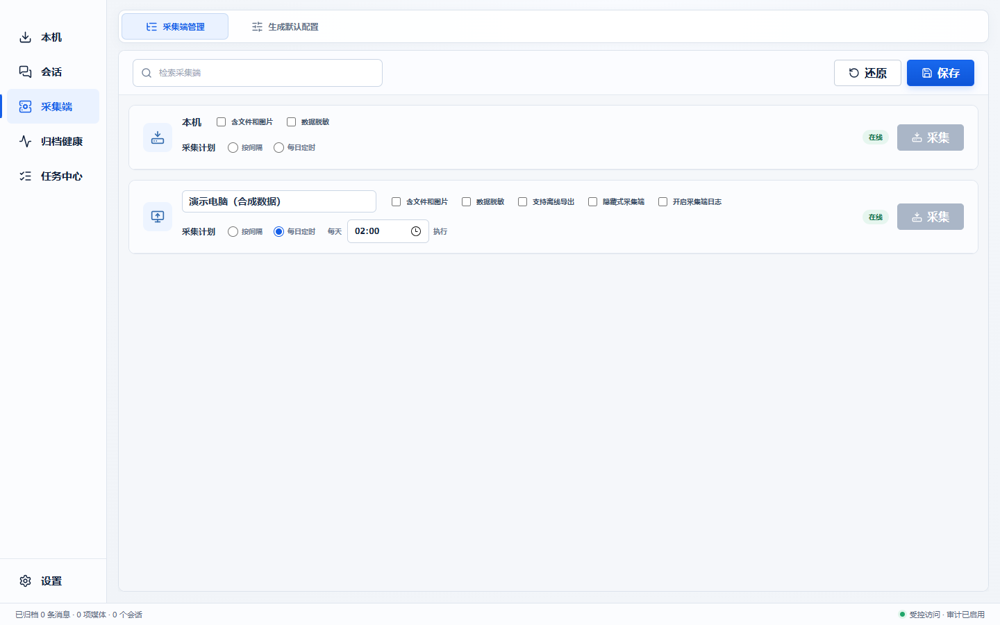

# 企业微信记录归档

将 Windows 本机的企业微信聊天记录保存下来，方便查阅、搜索和导出。支持多台电脑定时采集，集中管理记录。

[下载](https://github.com/TorbenXiong/wecom-archive/releases) · [使用指南](docs/user-guide.md) · [文档目录](docs/README.md)

## 开始使用

1. 下载并运行 `WeComArchive.exe`。
2. 只想导出本机记录：在“本机”选择格式，点击“开始导出”。
3. 需要查阅和搜索：在“会话”点击“采集本机”；也可导入采集端生成的 `.wca` 文件。

源数据只读，不修改企业微信记录。以下截图均使用合成演示数据。

## 查阅聊天记录

按会话查看历史消息、成员和引用内容，预览图片、打开附件，播放已采集的语音。

## 搜索并定位原消息

搜索全部归档记录，按会话、发送人、消息类型或日期筛选，点击结果回到原消息。

## 按需导出

导出为 HTML、CSV、Markdown 或 JSON，支持按会话、日期和筛选结果选择范围，可开启数据脱敏。

## 多台电脑定时采集

生成已绑定的采集端，在其他电脑运行；按固定间隔或每日定时采集，集中查看在线状态和执行结果。也支持离线导入。

## 使用须知

- 仅归档已获授权的数据；图片、附件和语音取决于本机缓存。
- 完整备份与迁移请使用[备份与恢复](docs/backup-recovery.md)，JSON 导出不能替代完整备份。
- 开发、部署和排障说明见[文档目录](docs/README.md)。

## License

MIT License. Copyright (c) 2026 Torben Xiong.
